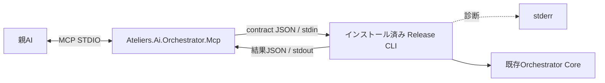

# STDIO MCP 技術仕様・導入手順

> 対象: `src/Ateliers.Ai.Orchestrator.Mcp`、CLI `--capabilities` と `run --stdin-json`。Phase 2の実装仕様。

## 1. 責務と構成



MCP専用プロジェクトは公式C# MCP SDKを使い、`run_orchestration`を登録する。Tool引数は既存TaskContractの`contract` JSON objectと実行設定で、契約の作成・意味解釈・検証はしない。MCPはCLI起動とプロトコル応答の受け渡しだけを担い、Coreや業務ロジックを参照・複製しない。

CLIは `LOCALAPPDATA` 下の固定実行ファイルと `install.json` を検査し、毎回`--capabilities`でprotocol v1の対応を確認する。非対応CLIは実行しない。契約を一時ファイルへ書かず、CLIの標準入力へUTF-8で渡す。既存の`run <contract.json>`、`start`、`validate`等は維持する。

## 2. CLIプロセス契約

### 能力照会

```powershell
& "$env:LOCALAPPDATA\Ateliers-Dev\Ai-Orchestrator\bin\Ateliers.Ai.Orchestrator.Cli.exe" --capabilities
```

```json
{"cliVersion":"0.0.2","protocolVersion":1,"commands":{"runStdinJson":true}}
```

### 実行

MCPはCLIへ次の形の引数を渡し、`contract` JSONそのものをUTF-8 stdinへ書く。Codex実行では`--codex-exe`を指定する。Codex CLIパスはTool引数または`ATELIERS_CODEX_CLI_PATH`で設定する。`fake`は決定的なローカル検証専用。

```text
Ateliers.Ai.Orchestrator.Cli.exe run --stdin-json --agent codex --codex-exe <absolute-path> [--runs <absolute-path>]
```

stdoutは1個のJSON objectだけを返す。CLI終了コードは`0`（操作完了。WorkflowはNeedsHumanInputを含む）、`2`（契約/引数不備）、`3`（実行/永続化失敗）。JSONの`ok`と`exitCode`を照合し、不一致・不正JSONはプロトコルエラーにする。

```json
{"protocolVersion":1,"ok":true,"exitCode":0,"runId":"...","state":"NeedsHumanInput","runDirectory":"...","error":null}
```

エラー応答は`ok:false`と`error.code`/`error.message`を持ち、契約エラーでは`details`も含む。stderrは人間向け診断用であり、stdoutへ混在させない。CLIの既存対話モードは従来どおりテキスト表示する。

### 終了とキャンセル

MCPのキャンセルトークンをCLIのstdin/stdout/stderr待機に伝え、キャンセル時はCLI子プロセスツリーをkillし、終了を待つ。子プロセスkill後は最終JSON応答や実行記録の完了を保証できない。MCP要求のキャンセルとして伝播し、成功として返さない。実行ディレクトリに部分記録が残る場合がある。

## 3. バージョン互換性

CLIのインストール版は`install.json`から読み、起動実体はPhase 1で定義された固定パスを使う。`--capabilities`の`cliVersion`が`install.json`と一致し、MCPが対応する数値版`protocolVersion`であることを照合する。MCPはCLIの将来のSemVer番号を固定値で比較しない。CLIとMCPの配布・更新は個別に行える。旧CLIやプロトコル不一致は`unsupported_cli_protocol`で停止する。

Phase 2対応CLIを含むReleaseが別途発行・配置されるまでは、現行インストール済みv0.0.1にMCPは接続できない。Phase 2ではRelease tagや公開を行わない。

## 4. 機密情報と出力上限

- MCPは契約JSON、CLI stdout/stderr、引数値をログへ記録しない。
- CLI子プロセスには`PATH`、Windowsシステム・ユーザープロファイルパス、`LOCALAPPDATA`、`CODEX_HOME`、明示されたCodex実行パス、HTTP(S) proxy変数だけを渡す。親プロセスのAPIキー・Token等を含む他の環境変数は継承しない。
- CLI stderrはMCPが排水し、tool結果へ転載しない。CLI内部の実行記録とAgentログは既存CLI仕様に従う。ログには機密情報が含まれる可能性があるため、runディレクトリのアクセス権と保持期間を管理する。
- stdout/能力応答の捕捉上限は64 KiB（能力応答は4 KiB）。超過またはプロトコル不正時は機械可読エラーにし、切り詰めたJSONを成功扱いしない。
- `runDirectory`は実行位置の識別に必要なため返す。親AIへrun記録をまとめて転送しない。

## 5. MCP SDKと参考実装

標準の`ModelContextProtocol` NuGet packageを使用する。Ateliers MCP Processes実装と同じくHost、DI、stdio transport、attribute-based tool discoveryの形を採用し、Ateliers MCP Toolsの既存Tool基底クラスやドメイン用NuGetへの依存は加えない。将来別リポジトリへ移せるよう、MCPプロジェクトはOrchestrator CoreへのProjectReferenceを持たない。

参照: [ateliers-ai-mcp-processes](https://github.com/Yuu503/ateliers-ai-mcp-processes)、[ateliers-ai-mcp-tools](https://github.com/Yuu503/ateliers-ai-mcp-tools)、[公式C# SDKのstdio transport](https://github.com/modelcontextprotocol/csharp-sdk/blob/main/docs/concepts/transports/transports.md)。

## 6. インストール・登録・起動

### MCPサーバーの配置

リポジトリを取得した開発者が、リポジトリ内のPowerShellスクリプトを実行してMCPを配置する。スクリプトは実行場所にかかわらず自身の位置からリポジトリ内のMCPプロジェクトを解決する。通常のMCP起動時にソース取得やbuildは不要。

```powershell
& .\scripts\mcp-installer\Install-AteliersAiOrchestratorMcp.ps1
```

配置先は`%LOCALAPPDATA%\Ateliers-Dev\Ai-Orchestrator\Mcp`です。`LOCALAPPDATA`には存在するユーザーの`AppData\Local`ディレクトリを指定してください。スクリプトはRelease / `win-x64` / self-contained / single-fileで一時ディレクトリへpublishし、成功とMCP実行ファイルを確認した後、既存のMCP配置先ディレクトリだけを全削除して成果物一式をコピーします。配置先、その祖先、配置先内にreparse point（junction、symlink等）がある場合は安全のため削除を中止します。publish失敗時は既存配置を変更しません。MCPなどの実行中プロセスがファイルを使用して削除できない場合は失敗を表示します。その場合は該当プロセスを終了してから再実行してください。

この暫定スクリプトは開発・検証用です。再実行するとMCP配置先のファイル一式を全削除・全置換します。配置先に手動で置いたファイルも削除されます。差分比較、バックアップ、ロールバック、バージョン管理、自動更新、正式Release配布は行いません。CLIはPhase 1 installerで別途明示的に配置し、`Install-AteliersAiOrchestrator.ps1 -Verify`で確認してください。CLIの`bin`、runデータ、その他のフォルダはこのスクリプトの対象ではありません。

### Codexへの登録

Codexの`config.toml`へMCP serverを登録する。ユーザー名は実際の絶対パスに置き換える。

```toml
[mcp_servers.ateliers_ai_orchestrator]
command = 'C:\Users\<user>\AppData\Local\Ateliers-Dev\Ai-Orchestrator\Mcp\Ateliers.Ai.Orchestrator.Mcp.exe'
args = []

[mcp_servers.ateliers_ai_orchestrator.env]
ATELIERS_CODEX_CLI_PATH = 'C:\Users\<user>\AppData\Roaming\npm\codex.ps1'
```

Codex CLI実行パスは`codex.exe`またはnpm配置の`codex.ps1`/`codex.cmd`など、現在のCLI実装が起動できる絶対パスを指定する。Windowsの`.ps1` shimはPowerShell経由で起動する。`.cmd` shimもWindows x64の`run_orchestration(agent="codex")` fixtureで起動と構造化結果の返却を確認した。設定例では明示的なshim起動経路がある`.ps1`を使う。ログイン状態はCodex CLI自身の認証設定を使う。MCP設定にAPIキーやTokenを書かない。

### 起動と動作確認

Codexを再起動するとMCPサーバーが子プロセスとして起動する。stdio protocolの疎通確認用PoCは再試験しない。ツール一覧に`run_orchestration`があること、CLIをインストールして`--capabilities`がprotocol v1を返すことを確認する。テストは`agent="fake"`で隔離した一時workingDirectoryを指定し、結果JSONの`ok`, `state`, `runDirectory`と出力先の記録を照合する。Codexの通常実行は本番契約とCodex CLI設定が必要。

PowerShellの実行ポリシーでスクリプト起動が制限される環境では、リポジトリルートで次のように現在のプロセスに限りBypassを指定できます。

```powershell
powershell -ExecutionPolicy Bypass -File .\scripts\mcp-installer\Install-AteliersAiOrchestratorMcp.ps1
```

PowerShell 7を使用する場合は`powershell`を`pwsh`に置き換えてください。

未配置CLIでは`cli_not_installed`、起動失敗や能力照会timeoutでは`cli_start_failed`または`cli_capabilities_timeout`、旧CLIまたは非対応protocolでは`unsupported_cli_protocol`、Codex path未設定では`codex_cli_not_configured`を返す。MCP/CLI更新により別のコンポーネントを自動更新しない。
